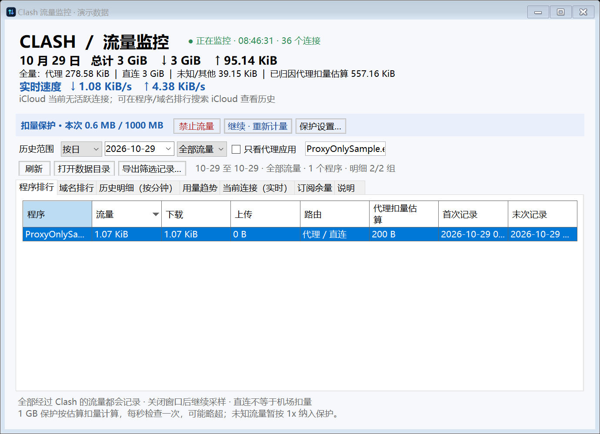
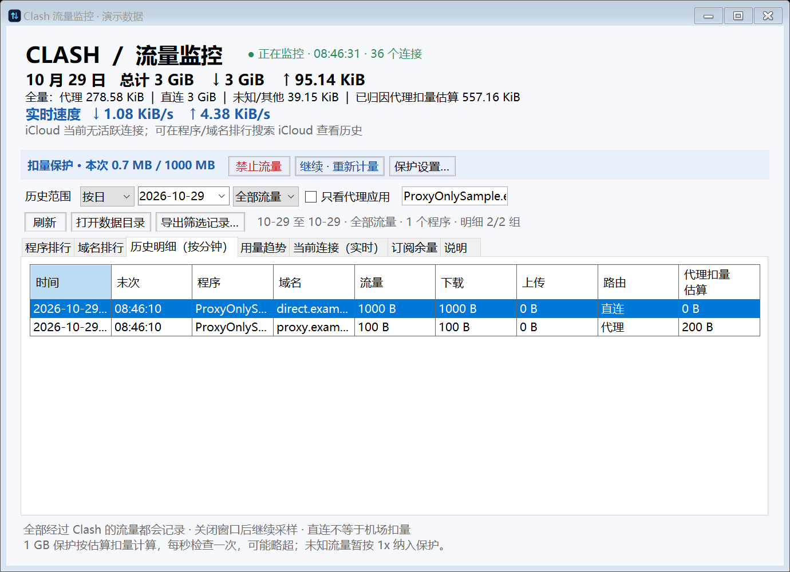
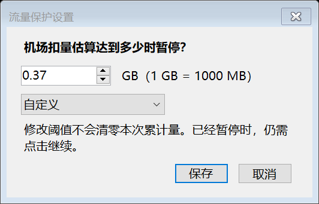

# Clash 流量监控

Windows 托盘工具，通过本机 Clash/mihomo 采集流量，展示程序、域名、当前连接和历史趋势，并提供按节点倍率估算的额度暂停保护。

## 运行要求

Windows、.NET 8 Desktop Runtime，以及已运行的兼容 Clash Verge/mihomo 本地内核。程序使用命名管道访问本机控制器；手动刷新订阅余量使用本地 `127.0.0.1:7897` 代理。不同客户端配置可能需要适配源码。

解压发布包，运行 `ClashTrafficMonitor.exe`。关闭窗口后继续在托盘采样；双击托盘图标恢复窗口，托盘菜单可退出或切换开机启动。移动程序目录后需重新设置开机启动。

## 流量与暂停保护

支持按日、周、月和自定义日期查看历史，筛选代理、直连、未知和拒绝流量，并导出 CSV。程序和域名排行支持按真实字节排序。只看代理应用筛选不影响后台完整采集。

默认保护额度为本次机场扣量估算 1 GB（十进制），可在保护设置中调整。代理节点名称中的 `2x`、`4x` 等倍率用于估算；直连不计入保护额度，未知路由暂按 1x。估算值可能与服务端账单不同；采样和控制延迟也可能导致超额，程序无法提供精确计费硬限额。

达到阈值或点击「禁止流量」后，程序保存原模式和 GLOBAL 选择，切换到 GLOBAL REJECT 并关闭连接。暂停影响所有经过 Clash 的联网，包括直连；未经过 Clash 的联网不受影响。点击「继续 · 重新计量」恢复并清零本次保护累计量。提高阈值不会自动恢复已暂停的连接，退出程序也不会自动恢复。阻断失败显示「保护待确认」。必要时可在 Clash 客户端手动恢复原模式和节点选择。

## 本地数据与隐私

数据保存在程序旁的 `data/`：每日 `clash_YYYY-MM-DD.csv`、累计额度 `budget.txt`、阈值 `limit.txt` 和暂停恢复状态 `paused-state.json`。历史包含程序、域名、路由和用量，请自行保护这些文件。发布包和源码仓库不包含个人历史、订阅配置或运行日志。

首次连接建立采样基线；程序未运行、内核断线或重启期间丢失的流量无法补记，未经过 Clash 的流量不可见。程序不抓取 TLS 内容。订阅余量默认读取本机缓存，可能过期；手动联网刷新只请求订阅响应头，不展示完整订阅地址。

## 开发

安装 .NET 8 SDK 后在项目根目录运行：

```powershell
dotnet run --project tests/Tests.csproj
dotnet publish src/ClashTrafficMonitor.csproj -c Release -o app --no-self-contained
```

`tests/` 为核心测试；`tests-ui/` 是需要 Windows 桌面和本机 Clash 的 UI 集成测试，会启动窗口并读取本机控制器，不建议在敏感环境直接运行。`assets-builder/` 为图标生成工具，`assets/` 保存应用图标源码。

发布包只含应用运行所需文件，不包含历史 CSV、额度状态、日志或调试符号。

## 界面预览

以下为当前程序控件导出的演示界面，示例数据不代表真实流量记录。




